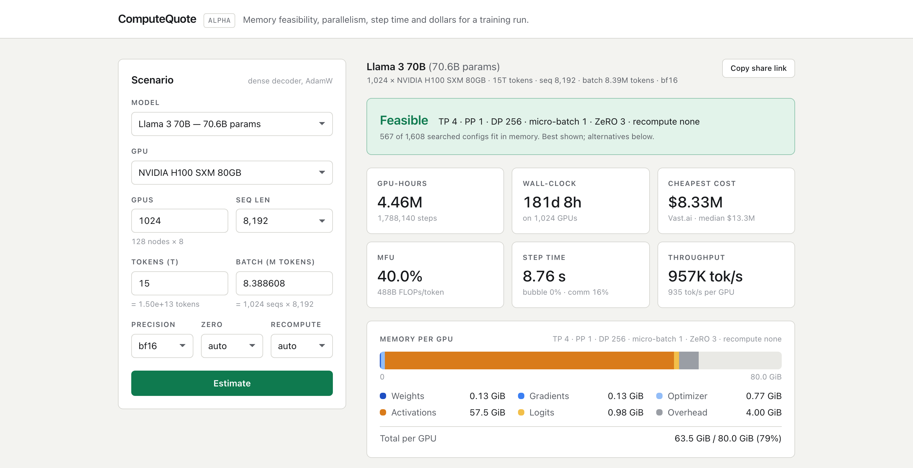
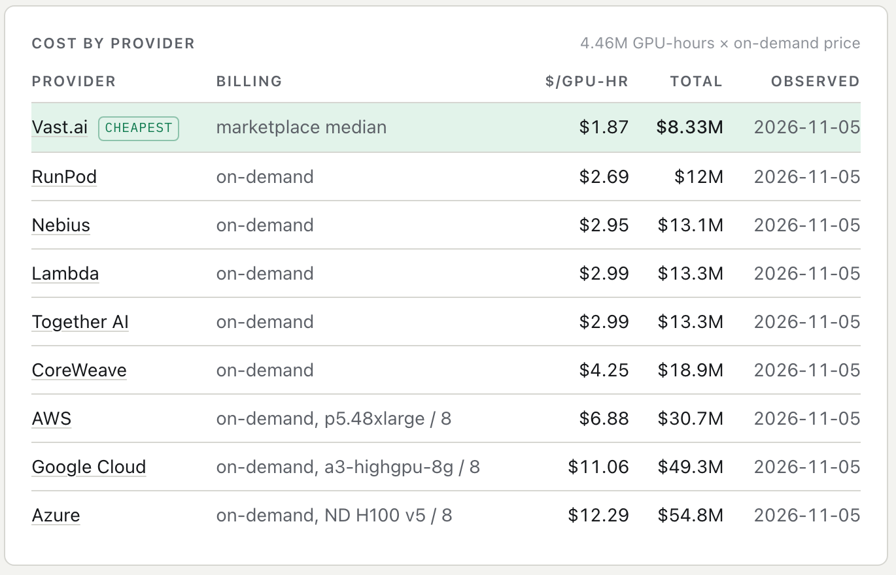
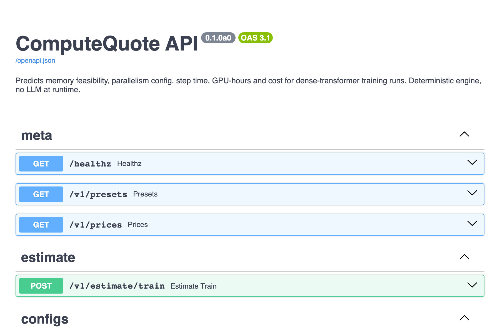
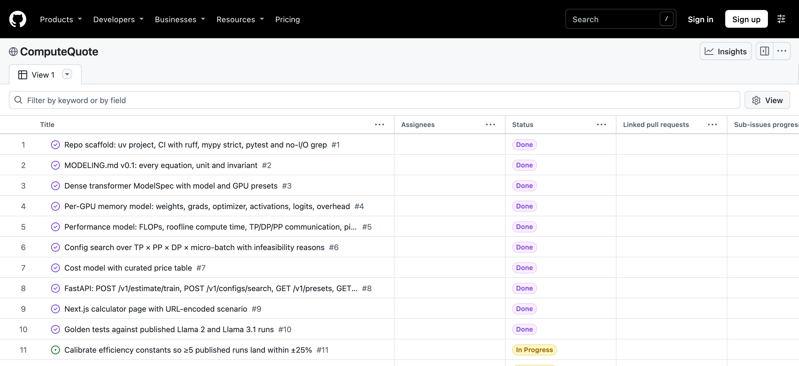
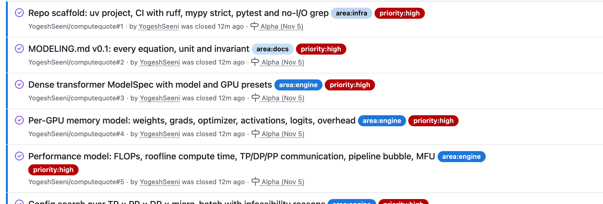

# ComputeQuote — Alpha Release & Task Backlog

CS146S Aut26 · Yogesh Seenichamy · November 5, 2026 · Repo: <a href="https://github.com/YogeshSeeni/computequote">github.com/YogeshSeeni/computequote</a> · Backlog: <a href="https://github.com/users/YogeshSeeni/projects/2">github.com/users/YogeshSeeni/projects/2</a>

## 1. Early working demo

ComputeQuote predicts what an AI training run will cost from first principles. The alpha takes a dense-transformer architecture (preset or custom), a GPU type and count, a token budget and a global batch, then: (1) counts parameters, (2) enumerates every tensor/pipeline/data-parallel split with micro-batch, ZeRO stage and recompute mode, (3) rejects configs that do not fit in GPU memory, with a reason, (4) ranks the rest with a roofline-plus-communication step-time model, and (5) converts the winner into GPU-hours, wall-clock and dollars across a price table. Every estimate is a shareable URL. The stack from the technical spec runs locally: a pure-Python engine (`engine/`, no I/O, 115 tests), a FastAPI service (`api/`) and a Next.js page (`web/`); `make api` and `make web` start it.

<figure><figcaption>Calculator: Llama 3 70B, 15T tokens, 1,024 × H100. Best of 1,608 searched configs (TP 4, ZeRO-3, 40% MFU), 63.5 of 80 GiB per GPU, 4.46M GPU-hours, 181 days. The URL encodes the scenario.</figcaption></figure>

<figure><figcaption>Same scenario priced per provider ($8.3M–$54.8M), cheapest highlighted, observation dates shown.</figcaption></figure>
<figure><figcaption>FastAPI service behind the page; the Pydantic schemas double as docs for teammates and agents.</figcaption></figure>

| Feature (proposal MVP list) | Status | Notes |
|---|---|---|
| Model spec input + presets | **Functional** | 8 presets (Llama 2/3, Mistral, Qwen) within 1% of model-card parameter counts; custom specs via API only |
| Memory model | **Functional** | Weights/grads/optimizer with ZeRO 0–3; activations for none/selective/full recompute under TP + sequence parallel; fp32 logits; fixed overhead |
| Config search | **Functional** | 1,608 candidates for the 70B scenario in 23 ms; infeasible ones say "needs X GiB, GPU has Y GiB" |
| Performance model | **Functional** | 6N + attention FLOPs, roofline vs peak and HBM, TP/DP/PP communication, 1F1B bubble, MFU. No interleaved pipeline yet |
| Cost + shareable URL | **Partial** | Exact-cent cost across 9 providers from a **curated, hand-entered price table** (approximate list prices, dated, staleness flags). Share links are query strings; short IDs are backlog |
| Validation vs published runs | **Partial** | 6 runs in `engine/validation.py` (below); no public validation page yet |
| Deploy, live prices, Postgres, inference, MoE, share cards | **Placeholder** | Not started; in the backlog |

**Validation snapshot** (engine v0.1, predicted ÷ reported GPU-hours): Llama 2 7B **0.92**, 13B **0.86**, 70B **0.96**; Llama 3.1 405B **1.11**; Llama 3.1 8B 0.38 and 70B 0.67 (misses). Four of six are inside the ±25% target. The misses are Llama 3.1 model-card figures that count every training stage, not only the 15T-token pretraining run the engine models; cluster sizes are assumed because they are unpublished. The one efficiency constant was calibrated once on this table, from 0.70 to 0.55.

## 2. Documented backlog

<figure><figcaption>Public GitHub Project board (33 issues) with status per item.</figcaption></figure>
<figure><figcaption>The same issues with priority and area labels and milestones (Alpha Nov 5 / Final Dec 10).</figcaption></figure>

Board: <a href="https://github.com/users/YogeshSeeni/projects/2">github.com/users/YogeshSeeni/projects/2</a>. Each issue has a title, description, status (Todo / In Progress / Done), a `priority:high|medium|low` label, an area label and a milestone; the whole backlog is generated by `scripts/backlog.sh` so it is reproducible. Single-person team, so no assignee. Counts: **Done 10** (all high), **In Progress 2** (calibration; short links), **Todo 21** (8 high, 9 medium, 4 low). Highest-priority next steps: calibrate on more runs and model interleaved pipelines; deploy the API (Fly.io) and web app (Vercel); replace the curated price table with nightly Vast.ai and RunPod collectors into Postgres; ship the validation page.

## 3. Reflection on AI/LLM tool integration

**Tools used.** Claude Code (Fable 5.1) for everything so far: plan mode turned the three project PDFs into an approved build plan; three parallel subagents implemented the memory model, the performance model and the Next.js page concurrently; the main session did cost, search, the API, calibration and this document. The GitHub CLI created the repo, labels, milestones, issues and board from a script. No LLM runs inside the product; the engine is deterministic.

**How it changed the process.** The spec-first workflow from the proposal held: `docs/MODELING.md` was written before any engine code, every function cites its section, and subagents were briefed with exact signatures and a TDD requirement. Three modules landed in about 40 minutes with 73 hand-derived tests and no interface mismatch except one introduced deliberately mid-build (uneven pipeline stages), which both engine agents flagged in their reports. Empty folder to running stack with 115 tests took one evening.

**Successes.** The engine agents cross-checked arithmetic with standalone scripts and documented two spec ambiguities instead of guessing. Hypothesis property tests (memory non-increasing in TP/PP/DP/ZeRO) came almost free once invariants were in the spec. Calibration was a five-line sweep because the engine has no I/O.

**Challenges.** The model recalled GPU specs, provider prices and published GPU-hour figures from memory, so the price table is labelled approximate and the validation table carries assumed cluster sizes; both need human verification before any real decision, which is why live collectors and a public validation page are high priority. Unit discipline needed a rule (`memory_bytes`, `step_time_s`) plus a mypy strict gate. And the agents are optimistic by default: the first efficiency constant gave 45–55% MFU where published runs imply 25–43%, and only the golden tests caught it.

**Insight.** Treating the modeling spec as the contract between human and agents beat reviewing code line by line: when a number looked wrong, the fix was a spec sentence plus a test, and the agents did the rest.
